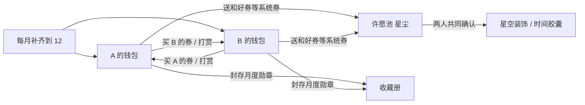

# 情侣商店与时间胶囊 · 项目计划

Sep 17, 2026 · @Yao He

## 定位

一个只属于两个人的小星空：白天在里面开小店互相买券，长期往里面埋时间胶囊。面向所有情侣，不专做异地；异地情侣只是天然更常打开它。

**它是什么**：两个人之间的一套轻量互动形式——问一句「我今天买的奶茶好喝吗」、打赏一枚币、上架一张「陪逛宜家券」、封存一封三年后才能拆的信。

**它不是什么**：不是家务积分表，不是关系账本，不是聊天工具，不是 AI 陪聊。任何让一方感到被催、被比较、被评价的机制都不进产品。

**目标**：作为 side project 积累现金流。付费模式跑不通就毙掉，不做大项目。

## 设计原则

这九条是讨论中定下的红线，后面每一个功能都要过一遍。

1. **不像账本**：不显示双方币余额对比、不做排行、统计只按券不按币；AI 总结不比较双方。
2. **主动权在「给」不在「要」**：动态是问句（「好喝吗」），打赏按钮在对方手里；没有「申请发币」。
3. **不像上班**：没有每日任务、打卡、月底清零。唯一的催促是「你买的火锅券快过期了」——催的是两个人去吃火锅，不是打开 app。
4. **币永远不卖钱**：订阅卖功能（总结、主题、历史、胶囊），不卖也不送币。这同时避开欧盟虚拟货币合规。
5. **AI 不进互动层**：不帮写券、不帮回复、不判断情绪。AI 只做低频辅助：季度/年度总结、上架灵感、提醒文案。总结只写事实和温和观察，用户可以不看。
6. **一次性的东西就卖贵，持续的东西就卖便宜**：实物卡 + 胶囊一次性收 25–40 欧；商店订阅每月 2–4 欧或年付 25–30 欧，一方付即可。
7. **服务消失了胶囊还在**：胶囊内容端到端加密，密文可导出，离线解密工具开源。「50 年」是营销话术，不是承诺。
8. **胶囊是星空里的一种物件**：数据模型从第一天就把券、胶囊、勋章、装饰都当作「星空里的物件」，以后加东西不重写。
9. **每个阶段都有毙掉条件**：见「商业模型」一节，不达标就停，不加功能救。

## 经济模型规则

币在两人之间流动，在系统券处沉淀进许愿池，在勋章和装饰处退出流通。没有一处碰真钱。

读法：币只在买券时换手，只在系统券、勋章、共同购买时离开个人钱包。

### 币

| 规则 | 内容 |
| --- | --- |
| 发放 | 每月 1 日补齐制：余额低于 12 补到 12，高于 12 不发。**注意：总量不守恒**——补给买方的币是新铸的，卖方收到的币不回收，卖得多的一方余额会持续上涨（例：A=12、B=12，B 花 5 → A=17、B=7，月初补齐后总量 29）。是否加回收机制见待决问题 |
| 主题 | 按月轮换 12 星座（九月 = 处女座币），价值相同，带铸造月份 |
| 流向 | 买方付出的币进入卖方钱包，带着「你买我火锅券时给的」记录 |
| 支付顺序 | 默认新币先花，买方可挑选用哪枚 |
| 收藏册 | 显示经手过的所有币，已送出的灰显「给了 TA」 |
| 月度勋章 | 月底持有本月币可封存 1 枚为勋章，退出流通，永久收藏 |
| 不做 | 不充值、不清零、不显示双方余额对比 |

### 券

| 规则 | 内容 |
| --- | --- |
| 上架 | 卖方自定名称、价格、保质期、限量；可设盲盒（买了才看到内容） |
| 默认券四档 | 1 币小事（拥抱券、今晚看什么你定券）· 2–3 币陪伴（陪逛宜家、按摩 15 分钟、听吐槽不给建议）· 5–6 币大事（周末由你安排、一天不看手机）· 8–10 币特权（免死金牌、许愿券） |
| 兑现 | 双方确认（卖方点「已履约」）；多张可批量确认；未履约的券一直挂着 |
| 过期 | 由卖方设的保质期决定；到期前提醒；过期币不退 |
| 月份印记 | 买到的券自动带月份，年底回顾按月翻 |
| 世界表现 | 上架 = 一颗垂悬星沿细线垂下；被买 = 变色；兑现 = 化回星星沉入水底（见「视觉世界设定」） |

### 系统券（不走定价，费用进许愿池）

| 券 | 获取 | 用法与约束 |
| --- | --- | --- |
| 和好券 | 只能来自对方赠与。付费途径：送方花 5 币，每月最多送 1 张。免费途径：纪念日、双方生日、两三个固定节日各 1 张，当天不送就过期 | 送时必须写一句话，用时显示。单方按下即生效，对方只收通知。收方最多持有 2 张未用；不过期；不能转送 |
| 反悔券 | 每月 1 张 | 取消一张未兑的券，币退回 |
| 加急券 | 花币，价格待定 | 贴在已买的券上，要求 48 小时内兑现 |

### 许愿池（星尘）

- 来源：所有系统券的花费。
- 花法：一方提议、另一方确认，和胶囊的双钥匙是同一个动作。可买：星空装饰（星座线稿、季节色调）、时间胶囊。
- 谁都逼不了谁：池里的星尘不属于任何一方，投币的行为（送和好券）本身就是对对方好。
- 第一版只显示「你们的星尘：47」，不做装饰。

## 问题库（双星）

一个问题就是一颗即开的小胶囊：两人各自写下回答，写时看不到对方，都写完才同时打开。它和胶囊是同一扬门，只是锁的不是时间而是「对方也写了」。

| 规则 | 内容 |
| --- | --- |
| 发起 | 拉取式：任一方想聊时从星空里「摸一颗暗星」抽一题，对方收通知。不做每日推送、不做连续打卡 |
| 开启 | 双方都写完即开；只有一方写了就一直挂着，不催；同时最多 2 题未完成，防止堆积成任务 |
| 题库 | 你自己维护、持续更新；分主题包（回忆、未来、小事、不好意思问的）；AI 可以帮你起草，但入库前你逐条审；用户乗能自己出题给对方 |
| 星空表现 | 一题 = 一对双星，一方写完亮一颗，都写完两颗连成一线 |
| 与券联动 | 某些题的回答可一键变成券（「你最想让我做的一件小事」→ 对方直接上架）；回答不给币，避免变成赚币任务 |
| 与胶囊联动 | 面向未来的题（「你觉得三年后我们在哪」）回答后自动封成胶囊，到期才开——这是胶囊最自然的引入方式；已开的回答可双方同意封存为长期胶囊 |
| 与总结联动 | 回答是季度/年度总结最好的材料，比券的流水更有内容 |
| 付费 | 基础题库免费；主题包和自定义出题进订阅 |

提醒：双方写完才开的每日问答是 Paired 的核心机制，已被验证有人要，但不构成差异。差异在拉取式不催、回答能变成券和胶囊。

## 一词日记与「上一次」（2026-10-06 新增，草案）

每天用一个词记下这一天最有意义的事（「散步」「火锅」「吵架又和好」），时间久了就能回答「我们上一次一起散步是什么时候」。来源：用户看到的一个已跑通的同类商业案例（待补名称和数据）。

| 规则 | 内容 |
| --- | --- |
| 记录 | 一天一格，一个词或一个短语；任一方都能写，两人共用同一格，也可以各写一个。不写这一天就空着，空着没有任何后果 |
| 提醒 | **默认关**，在设置里自己打开、自己选时间；每天最多一条，措辞是邀请不是催（「今天有什么想记一下的吗」）；没有连续打卡、没有补签、漏掉不提示 |
| 词表 | 自动补全优先用两人自己写过的词，让「散步」不会散成「去散步」「一起走走」；可以手动合并同义词。不用 AI 自动归类 |
| 「上一次」 | 搜一个词或点一个常用词，看到「上次一起散步：9 月 12 日，那天还写了『下雨』」，以及按时间排列的每一次 |
| 呈现方式 | 显示日期和那天的内容，**不显示「已经 23 天没有……」这类倒计时**：「多久没做」读起来像指责，「上次是哪天」读起来像回忆 |
| 世界表现 | 今天写的词浮在水面（「现在」层），第二天开始慢慢下沉，越久越深；「上一次」= 下潜到那一层，那颗词被点亮 |
| 与券联动 | 看「上一次」时可以顺手上架一张相关的券（「散步券」），按钮不主动弹出 |
| 与总结联动 | 季度/年度总结的主要素材，比券的流水更像日记 |
| 付费 | 记录和「上一次」查询免费；完整年历视图、导出进订阅 |

风险：它离红线 3「不像上班」最近。判断标准是一个月不写也不会有任何东西变灰、变暗或被提示。

## 视觉世界设定：月亮船、天空与海

用户是一个坐在海面月亮船上的视角：头顶是天空，脚下是清澈的海。水面是「现在」，天上是未来（越远越久），水下是过去（越深越久）。本节取代前文所有「星空大厅」的描述；风格基调是柔光星云（方案 D），小王子式的诗意加一点真实物理，以 three.js / Blender / shader 能做出的效果为限。

### 场景元素

| 元素 | 设定 |
| --- | --- |
| 视角 | 默认仰视 45° 看天空；永远看不到自己；左右上下拖动转动视角，双指缩放可下潜穿过水面 |
| 月亮船 | 一轮弯月，一头高一头低，发微光；默认视角看不到，往下或侧面看才露出一角；水面有它的倒影；水下部分精致静止，水上部分从水下看被波光扭曲 |
| 背景天空 | 银河和繁星；颜色跟本地时间走：夜晚深空星河，白天蓝天丝云无星河，黄昏霞光上暗下亮带少量背景星 |
| 垂悬星 | 由一根根看不到头的细线从天上垂下的明亮星星；细线上有呼吸灯效果；近亮远暗逐渐隐去；可有不同颜色（颜色区分是谁上架的 / 物件类型）；白天仍亮但不如夜晚，黄昏被霞光映出微红 |
| 流星 | 纯装饰：偶尔划过，比真实流星慢一点，留彗尾，不承载任何待办。点一下等于「摸一颗暗星」的快捷方式，可以抽一题；不点什么都不发生，也不会再划一次来提醒 |
| 乌云 | 近处飘浮、像纱一样半透明；遮住背景星但垂悬星因为近且亮仍能隔着纱看到；乌云和浪高 = 对方选择的心情，只在对方屏幕上显示 |
| 水面 | 清澈；远处倒影多、近处少；垂悬星的倒影比背景星明显；倒影和水底宝箱跟着水面扭曲 |
| 水下 | 宝箱大小远近错落，一直到远方隐入水中；下潜后扭曲几乎不见；一丝丝星光从水面折射下来；仰视可见波光粌粌的水面、被折射的月亮船和星空，垂悬星更清晰 |

### 物件在世界里的位置

| 区域 | 放什么 | 规则 |
| --- | --- | --- |
| 天上近处 | 未兑现的券（垂悬星） | 颜色 = 谁上架的；快过期的呼吸变快 |
| 天上中景 | 等对方回答的问题（双星） | 一方写完亮一颗，都写完连线 |
| 天上远处 / 银河 | 时间胶囊 | 越远越久；临近到期逐渐变亮靠近 |
| 流星 | 无（装饰；点击可抽题） | 抽到的题按双星规则走；答完落进海里变成珍珠 |
| 水面 | 今天的动态（「奶茶好喝吗」）、钱包里的币（星光倒影）、许愿池星尘（倒影里的闪点） | 「现在」层 |
| 水下浅处 | 最近兑掉的券、刚答完的问题 | 按月成层 |
| 水下深处 | 往年的宝箱、勋章、已开的胶囊、年度回顾（每年一个大箱子） | 越深越久 |

铁律：世界是列表的皮。每一层都有普通列表视图，长按或右上角随时切换；办事用列表，氛围用世界。

### 关键动效

- 获得一张券 / 一颗垂悬星：一颗星从天上由远到近沿细线垂下来，停在近处开始呼吸。
- 点击垂悬星：星星沿一条弧线飞到屏幕前，展开成一张券。
- 使用后：券化回一颗星，落入水面沉到水底（不做变成宝箱的动画）。
- 打开宝箱：一个光点从箱里飘浮上来，展开给用户看。
- 流星被点击：停下，展开一道抽到的题；双方答完后落进海里。没人点就自己划走。
- 下潜：相机 y 从水上过渡到水下，穿过水面那一帧切换渲染模式。

### 技术实现要点

- Flutter `FragmentProgram`（GLSL，Impeller）或 SwiftUI Metal shader 或 react-native-skia SkSL 都能跑全屏水面 shader；已有的本地水面 shader 可迁移。
- 折射：水下场景先渲染到离屏纹理，水面 shader 用法线扰动后的 UV 采样；水下仰视同一套反过来。天空倒影是最便宜、效果最好的一步。
- 星星用一次 draw call 的精灵批量画；垂悬星的细线和呼吸光用顶点颜色 + 时间 uniform。
- 性能：待机降到 30fps 或只在触摸/动画时重绘；进后台立刻停；低电量退化为静态渐变 + 正弦波。
- 分期：阶段 1 只做渐变天空 + 正弦波水面 + 星星精灵，水下是按月列表；阶段 2 上水面 shader + 天气心情 + 天空倒影；阶段 3 才做下潜、折射、水下宝箱、仰视星空。

### 概念图清单（gpt-image 生成）

1. 仰视夜空，干净，五颗近处垂悬星，一颗流星
2. 仰视夜空，近处纱状乍云，无流星，背景星被遮、垂悬星隔纱可见
3. 仰视白天，蓝天丝云，无星河，五颗垂悬星亮但不如夜晚
4. 仰视黄昏，霞光，上暗下亮，少量背景星，垂悬星微红
5. 平视夜晚，水面 + 月亮船一角 + 星空，远处倒影多近处少，水下隐约宝箱
6. 俯视夜晚，月亮船和星空的倒影，宝箱清晰但被水面扭曲
7. 水下平视，宝箱错落到远方，星光从水面折射下来
8. 水下仰视，波光水面、被折射的月亮船和繁星，垂悬星更清晰

## 分期路线图

先用商店验证「情侣会不会拉着对方一起用」，再用订阅验证「会不会付 3 欧」，最后才投入胶囊和实物。每一阶段的工时按业余时间估。

| 阶段 | 范围 | 工时 | 进入下一阶段的条件 |
| --- | --- | --- | --- |
| 0 概念验证 | 月亮船世界 + 券卡片 + 实物卡的概念图 3–5 张，**先定下唯一的视觉方向**；一页产品简述；问 10 对情侣「会不会用、会不会花 3 欧/月」 | 1–2 周 | 至少 5 对说会用，3 对说会付 |
| 1 MVP 商店（免费） | 配对；动态（问句 + 打赏/回复/点赞）；商店（上架/限量/盲盒/购买/双方确认/保质期）；币补齐制 + 星座主题；和好券、反悔券；按券的历史；静态天空（阶段 1 分期）；默认券库；问题库基础版（抽题、双写即开、双星） | 6–8 周 | 50 对完成配对；双方 7 日留存 ≥ 40% |
| 2 付费层 | 季度 AI 总结；上架灵感；年度回顾自动封存为胶囊（胶囊的第一次登场）；月度勋章、收藏册；订阅接入 | 3–4 周 | 付费转化 ≥ 5%，或 30 对付费 |
| 3 留存 | 许愿池花法：第一批星空装饰；电子宠物（语料池驱动，只对事件反应）；加急券 | 3–4 周 | 月留存有可见提升 |
| 4 时间胶囊 | 双人盲存；门限密钥（A / B / 时间份，任意两份可开）；到期自动开 / 提前双方同意开；见证人机制（邮件人工确认 + 30 天冷静期）；密文导出 + 离线解密工具；用星尘购买；远星表现 | 5–6 周 | 付费用户中 20% 封了胶囊 |
| 5 实物 NFC 卡 | 定制卡面（星图）；卡上存加密份额（PIN 保护）；到期邮件提醒；一次性 25–40 欧；先小批量 50 套 | 4 周 + 供应链 | 首批卖完 |
| 后续备选 | 国内区部署；异地功能（两地真实天空、定时送达语音、见面倒计时、冷静期状态）；遗言/数字遗产托管（不承诺法律效力） | — | 前面阶段都站住了再说 |

阶段 1 不做：宠物、装饰、胶囊、实物、任何 AI。商店的反馈周期是天，胶囊的是年，所以先商店。

**美术优先（2026-10-06 定）**：每个阶段的顺序是「技术可行性 demo → 美术与视觉定稿 → 再加功能」。理由：美术是最难的部分，也是能让产品传播的部分；美术做不出来，后面的功能都没意义。所以阶段 0 的核心产出是一套风格统一、能拿出去给人看的画面，而不只是一份问卷。

## 技术架构

后端用 Rust，客户端用一套代码跨 iOS/Android，每个区域一套隔离部署，胶囊内容服务器只存密文。

| 层 | 选型 | 理由 |
| --- | --- | --- |
| 后端 | Rust（axum）+ PostgreSQL + 对象存储 | 你的主力语言；门限密钥和加密都有成熟 crate；作品集价值 |
| 客户端 | Flutter（待定，备选 React Native） | 星空是自绘动画，Flutter 的 canvas 和动画更顺手；一套代码两个平台 |
| 业务核心 | 币/券/系统券/许愿池的状态机，所有变更走事件日志 | 历史记录、年度回顾、AI 总结都从事件日志生成；一对情侣 = 一个聚合根 |
| 世界物件 | 统一的 `SkyObject` 抽象：coupon / capsule / medal / decoration / moment | 以后加物件不重写世界 |
| 胶囊加密 | 内容用随机密钥 K 加密；K 用 Shamir 2-of-3 拆为 A 份、B 份、服务器时间份；时间份到期才释放（后续可用 drand tlock 硬锁）；见证人持各自份额的托管副本 | 服务器不接触明文；一方去世靠见证人份凑齐；服务关闭靠导出的密文 + 份额 + 开源工具恢复 |
| NFC 卡 | 卡上存用 PIN 加密的份额；普通 NTAG 起步，安全芯片卡作为高配 | 卡只是最好用的一份，不是单点 |
| 区域 | 欧盟一套（Hetzner，德国）；国内一套（后续）；同一代码不同配置 | 一对情侣的共享数据落在配对时选定的区域；跨境配对需国内方单独同意 |
| 可替换层 | LLM 接口抽象；登录（Apple/Google ↔ 微信/手机号）；内容审核钩子 | 国内部署时只换实现不改业务 |
| 支付 | 苹果/Google 内购 | 两个区域都省事 |
| 定时任务 | 月初补齐、券到期提醒、季度总结批量生成、胶囊到期释放时间份 | 总结走 Batch API 五折 |

照片上传前客户端剥掉 EXIF（尤其 GPS）。

## AI 的使用边界与成本控制

用小模型、只放在低频动作上，一对付费情侣每月 AI 成本控制在 5 美分以内（价格量级按 2026 年 9 月小模型估，上线前复核）。

| 功能 | 频率 | 单次 token（入/出） | 小模型成本 | 边界 |
| --- | --- | --- | --- | --- |
| 季度总结 | 每季 1 次，批量生成 | 5–10k / 500 | < 1 美分 | 只写事实和温和观察；不比较双方；做成可以不拆的信封 |
| 年度回顾 | 每年 1 次 | 10–20k / 800 | 1–2 美分 | 自动封存为胶囊 |
| 上架灵感 | 每天 ≤ 3 次，按输入哈希缓存 | 1–2k / 150 | 可忽略 | 只推荐「上架什么」，不替用户写 |
| 到期提醒文案 | 每券 1 次 | 几百 | 可忽略，可用模板 | — |
| 宠物台词（阶段 3） | 语料池为主，实时 ≤ 1 次/天 | 1k / 100 | ≈ 1 美分/月 | 只对具体事件反应，不推断情绪、不开导 |

防滥用五层：

1. 没有通用入口：后端只暴露具体动作，prompt 由服务端拼。
2. 按动作配额、绑定情侣对；结果落库，重复请求返回缓存。
3. 输入输出封顶：券名限字数、事件列表截断、max\_tokens 写死。
4. 能批量的走 Batch API 定时任务。
5. AI 在付费墙后；服务端每日花费阈值超过即降级为模板；供应商后台设硬性月上限。

## 合规与区域

第一版只上 App Store 国际区（含港台新马），数据存德国；国内区等产品跑通、备案完成再上。以下是讨论中碰到的点，法律细节动手前需要再确认，这不是法律意见。

| 主题 | 做法 |
| --- | --- |
| GDPR 基本面 | 服务器只存密文 + 少量元数据，属于轻量控制者；与 Hetzner 签标准 DPA |
| 删除权与双人数据 | 条款写明共享内容为双方共有；一方退出只删自己账号和自己的密钥份，密文保留到胶囊到期或双方同意销毁；删掉 A 的份后 B + 时间份仍能到期打开 |
| 分手态 | 胶囊默认永久锁死，双方同意才销毁；商店数据各自导出后冻结 |
| 去世 | 见证人机制；德国判例下数字遗产由继承人继承，继承人合法要求时需能交出去世方的份额 |
| 数据留存 | 胶囊设上限（如 50 年）并写进条款；不用「永久」 |
| 长期预付 | 定价拆为一次性「创建 + 实物卡」（当下履约）+ 可选低价年度托管；避免履约义务拖十年 |
| 虚拟货币 | 币不能用真钱买、不能兑真钱、不能跨情侣对转移，因此不触发支付/电子货币监管 |
| 遗嘱方向 | 只做加密保管，不起草、不宣传法律效力；德国私人遗嘱需手写签名，电子遗嘱仆美国部分州认可 |
| 国内区 | 需 ICP 备案（国内主体已有）+ 境内服务器 + 内容审核接口 + 国产模型；国内用户数据存境内 |
| 跨境配对 | 2024 年起小规模、非敏感个人信息出境可免安全评估（记得是年 10 万人以下，需复核）；共享数据落国际区，国内方单独同意 |

## 商业模型、单位经济与毙掉标准

两条收入：商店订阅（持续、便宜）和胶囊 + 实物卡（一次性、贵）。几百对付费用户覆盖成本，几千对是可观的副业收入；它不会成为大公司。

| 项 | 免费层 | 订阅（一方付即可） | 胶囊 + 实物卡 |
| --- | --- | --- | --- |
| 包含 | 配对、动态、商店全部基本功能、币、和好券 | 季度/年度总结、上架灵感、星座币主题、勋章与收藏册、完整历史、胶囊功能 | 一个胶囊 + 两张定制 NFC 卡 + 到期仪式 |
| 价格 | 0 | 2.99 欧/月 或 24.99 欧/年 | 29–39 欧一次性 |
| 成本/对/月 | 服务器摊销，接近 0 | AI < 0.05 欧 + 平台抽成 15–30% | 卡片、信封、邮费约 8–12 欧 |
| 为什么免费层要够用 | 被拉的那一方不能一上来就撞付费墙，否则配对就断在这里 | 付费方是「为两个人买」，心理上是礼物 | 定位是礼物不是 app，参照系是纪念日礼物 |

毙掉标准（任一触发就停，不加功能救）：

- 阶段 0：10 对里不到 5 对愿意用。
- 阶段 1 上线 8 周后：配对完成对数 < 50，或双方 7 日留存 < 25%。
- 阶段 2 上线 8 周后：付费对数 < 15 且转化 < 3%。
- 任何阶段：每周投入超过业余时间能承受的上限连续一个月。

## 验证指标

真正要验证的只有一件事：情侣会不会拉着对方一起用。其他指标都是它的前后置。

| 指标 | 定义 | 阶段 1 目标 |
| --- | --- | --- |
| 配对完成率 | 发出邀请后 72 小时内对方完成注册的比例 | ≥ 50% |
| 首周上架 | 配对后 7 天内双方各自上架 ≥ 1 张券的情侣对比例 | ≥ 60% |
| 双方 7 日留存 | 两人都在第 7 天打开过 | ≥ 40% |
| 券兑现率 | 30 天内被买的券中完成双方确认的比例 | ≥ 50% |
| 互动对称度 | 一对里双方动作数之比（只你看，不给用户看） | 多数对在 1:3 以内 |
| 自然传播 | 新配对中来自已有用户推荐的比例 | 观察，不设目标 |

## 待决问题与风险

待决（阶段 0 结束前要定）：

- [ ] 产品名和域名
- [ ] 客户端框架：Flutter 还是 React Native
- [ ] 美术：自己画、AI 生图后修、还是外包一套星空 + 券卡片模板
- [ ] 每月补齐数（12 是假设）和默认券定价是否合理，阶段 1 用数据调
- [ ] 和好券免费节日列表按地区配置还是用户自选
- [ ] 首发语言：中文 + 英文同时，还是先中文
- [ ] 胶囊时间份的实现：服务器持有并承诺，还是第一版就用 drand tlock
- [ ] **唯一视觉方向**：现有 8 张概念图是写实 3D 奇幻风，与 visual-directions 推荐的「A 天空 + B 手里」以及本文写的「方案 D」三者都不一致，选一个，其余删掉
- [ ] 币回收：要不要让高余额的一方回流（如超过上限的部分进许愿池），还是保留「一方变成百万富翁」的乐趣，只确保界面不出现对比
- [ ] 产品形态：独立 app，还是 moonbao 的多人模式；可能与 IT 朋友合作，分工和所有权要在动工前写下来
- [ ] 一词日记的提醒：默认关是否太弱，阶段 1 用数据看
- [ ] 「上一次」参考案例：补上名称、定价和留存数据

风险：

| 风险 | 应对 |
| --- | --- |
| 情侣不互相安利，增长为零 | 阶段 0 先问；阶段 1 的毙掉标准就是为此设的 |
| 币券机制被玩成关糶账本，引发争吵 | 不比较、不排行、只按券统计；总结可以不看；互动对称度只你监控 |
| Couple Coin 类产品先做出星空和盲存 | 壁垒不在单个功能，在气质和美术的一致性；快上线竝争不过就毙 |
| 实物卡供应链和退换货吃掉业余时间 | 首批 50 套手工处理；卖完再考虑自动化 |
| 胶囊一方去世/分手时产品表现不得体 | 见证人 + 冷静期；分手默认锁死；这两个流程在阶段 4 单独设计评审 |
| 你自己的时间 | 每阶段工时写死；超期一倍就停下来重评 |

## 未来两周的行动清单

阶段 0 的全部内容，目标是在写任何代码之前拿到 10 对情侣的回答。

- [ ] 把经济模型一节整理成状态机（券、和好券、币的所有状态和转移）
- [ ] 月亮船世界、商店列表、一张券、实物卡的概念图各 1 张（8 张场景图已在 `assets/ui-concepts/`）
- [ ] 一页产品简述（给朋友看的版本，不是这份计划）
- [ ] 找 10 对情侣聊，固定问三个问题：会不会拉对方一起用、会不会花 3 欧/月、第一张想上架的券是什么
- [ ] 定产品名，注册域名和 App Store 开发者账号
- [ ] 定客户端框架，跑一个能画星空动画的空项目
- [ ] 后端骨架：Rust + Postgres + 事件日志表，不写业务逻辑
- [ ] 确认 Hetzner 对象存储和 DPA

两周后按「毙掉标准」阶段 0 那条决定进不进阶段 1。
